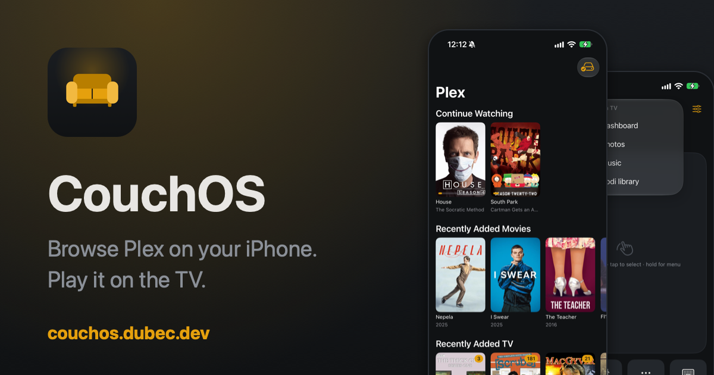
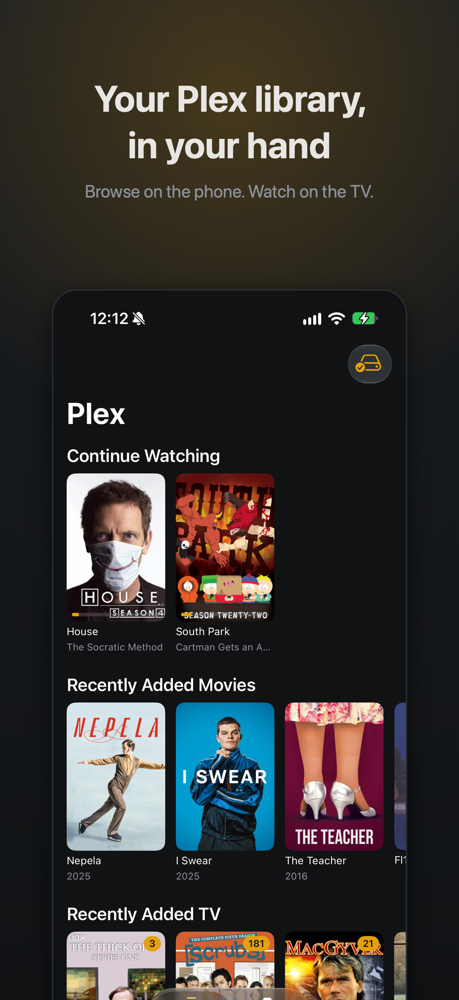
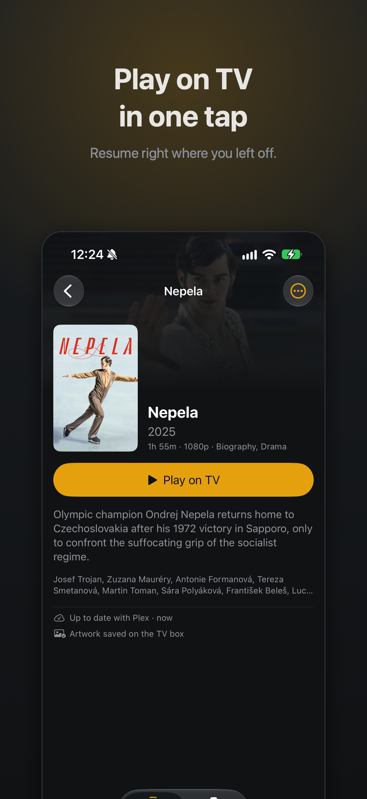
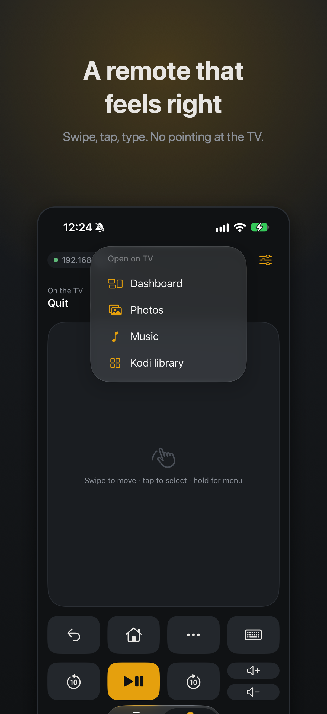
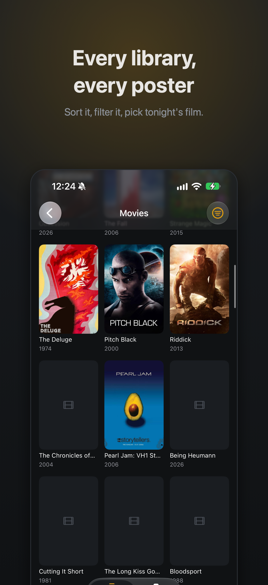

<p align="center">
  
</p>

<h1 align="center">CouchOS</h1>

<p align="center">
  <b>A calm, single-purpose TV box on a Raspberry Pi.</b><br>
  Plex when you sit down, AirPlay when you share, a quiet dashboard when nobody's watching.
</p>

<p align="center">
  <a href="https://couchos.dubec.dev">Website</a> ·
  <a href="repos/couchos-app/README.md">iPhone app</a> ·
  <a href="dashd/README.md">Dashboard</a> ·
  <a href="#1-build-the-base-image-on-the-mac">Build it</a> ·
  <a href="#api-no-auth-trusted-lan">API</a>
</p>

---

## The phone is the remote

Browse the whole Plex library on the iPhone, tap **Play on TV**, and the box plays it. The phone never streams. The same app is an Apple TV-style touchpad, a keyboard for the TV, and the switch for TV power, volume and Bluetooth speakers.

<table>
  <tr>
    <td align="center" width="25%"><br><sub><b>Your library, in your hand</b></sub></td>
    <td align="center" width="25%"><br><sub><b>Play on TV in one tap</b></sub></td>
    <td align="center" width="25%"><br><sub><b>A remote that feels right</b></sub></td>
    <td align="center" width="25%"><br><sub><b>Every library, every poster</b></sub></td>
  </tr>
</table>

## What's in the box

A minimal media appliance for a **Raspberry Pi 3B+** driving a Samsung TV over HDMI:

- **Plex** on the TV: Kodi 21 (GBM, hardware H.264) + [PM4K](https://github.com/pannal/plex-for-kodi) in its kiosk mode, so the TV boots straight into Plex
- **AirPlay** from iPhone/Mac: [UxPlay](https://github.com/FDH2/UxPlay) 1.73.7 receives, Kodi plays it on top of Plex. No modes: start mirroring and the TV wakes and shows it; stop and Plex is back immediately
- **TV remote** works via HDMI-CEC; phone control via the iOS app (`repos/couchos-app`), the Kodi app, or the JSON API; `http://beelzebub-tv.local/` is an info dashboard
- **Dashboard** when the TV is idle: clock, weather for Bratislava Staré Mesto, and a new frog every day (Kodi screensaver + `dashd`, see [`dashd/README.md`](dashd/README.md))
- **Bluetooth speaker** (e.g. JBL) via PipeWire
- **1 TB HDD** at `/srv/media` for local photos, music and videos

## Architecture

```
 iPhone ── AirPlay ──► uxplay (receive only) ──RTP :5000/:5002──► airplay-bridge ──MPEG-TS udp :5010──┐
                          │ -dacp file (exists while connected)                                     │
                          ▼                                                                         ▼
 iOS app ── TCP :9090 ─────────────────────────────────────────────────────────────────► kodi (GBM) + PM4K ──HDMI──► TV
         └─ HTTP :8765 ──► couchd ── JSON-RPC: Player.Open/Stop, CEC ──────────────────►   (never stops)
 Browser ── :80 ──► couch-web (podman, Caddy): dashboard; /api → couchd, /v1 → dashd
 Open-Meteo, iNaturalist ──► dashd :8766 ── NotifyAll ──► Kodi screensaver (TV dashboard)
```

- **The TV is always Kodi + Plex.** AirPlay is a video Kodi plays on top: when UxPlay's `-dacp` file appears, couchd opens `udp://127.0.0.1:5010/airplay.ts` in Kodi (refresh-rate switching paused, TV woken over CEC). When it disappears, couchd stops the video and Plex is exactly where it was. No Kodi restarts.
- Kodi decodes AirPlay video in hardware (V4L2 mem2mem via ffmpeg), which copes with iPhone mirror sizes (1920×886, portrait, rotation). UxPlay's own GStreamer V4L2 path crashed on them.
- Kodi, UxPlay, the bridge, PipeWire and couchd run natively as **systemd user services** of the `tv` user. **Podman** (rootless quadlet) runs the dashboard and is the place for future add-ons.
- Avahi advertises `_http._tcp` (web UI), `_couchos._tcp` (API), Kodi (`_xbmc-jsonrpc`), and AirPlay (`_airplay`, `_raop`).

## Layout

| Path | What |
|---|---|
| `image/` | pi-gen config and the `stage-couchos` stage (replaces stock stage2). `build.sh`, `flash.sh` |
| `uxplay/` | Docker build of UxPlay for trixie arm64 → `uxplay/dist/` |
| `ansible/` | Everything on top of the base image (roles: base, tv_user, storage, audio, bluetooth, kodi, uxplay, couchd, web) |
| `couchd/` | Control daemon (Python stdlib only) |
| `dashd/` | Dashboard daemon (Rust): widget data for the TV and the phone. `build.sh` → `dashd/dist/` |
| `web/` | Web UI (single static page) |
| `repos/couchos-app/` | iOS remote app (SwiftUI, `dev.dubec.couchos`): [README](repos/couchos-app/README.md), [changelog](repos/couchos-app/CHANGELOG.md), [style manual](repos/couchos-app/docs/BRAND.md) |

## 1. Build the base image (on the Mac)

Needs Docker (arm64, native on Apple Silicon).

```sh
image/build.sh            # ~4 min → out/image_<date>-couchos.img.xz (pi-gen is cloned to ~/.cache/couchos)
uxplay/build.sh           # ~2 min → uxplay/dist/uxplay-1.73.7-trixie-arm64.{tar.gz,DEPENDS}
dashd/build.sh            # ~5 min → dashd/dist/dashd-0.1.0-trixie-arm64
```

The image is pi-gen stage0 and stage1 plus `stage-couchos`, which:
- installs only: ssh, sudo, NetworkManager, avahi, bluez, podman, python3, v4l-utils, rpi-swap (zram), raspberrypi-sys-mods
- creates admin `jdubec` with keys from `https://github.com/Sibyx.keys`: key-only SSH, passwordless sudo, password locked
- turns Wi-Fi off (`dtoverlay=disable-wifi`), leaves Bluetooth on, and turns the 3.5 mm jack off
- tunes `config.txt` for media (CMA 256 MB, gpu_mem 128 for the H.264 decoder) and forces HDMI on (`video=HDMI-A-1:1920x1080@60D`)
- removes the Pi 5 kernel, kernel headers, docs, man pages and locales, and disables apt timers. Ansible owns updates

## 2. Check and flash

```sh
image/inspect.sh          # mounts the image read-only: SSH key, sshd, cmdline, hostname, ...
diskutil list physical    # the built-in reader shows up as "internal, physical"
image/flash.sh disk22     # asks you to type the disk name again, then sudo dd
```

## 3. Configure with Ansible

Boot the Pi with Ethernet and HDMI connected. A fresh image announces itself as `couchos.local` (images built after this change: `beelzebub-tv.local`).

Home naming convention: flat mDNS names `beelzebub-<device>.local`. Single-label `.local` names resolve on iOS, macOS and Linux, and Bonjour/AirPlay services stay in the default `local.` domain. The inventory name is the hostname, so this Pi is `beelzebub-tv`.

```sh
cd ansible
ansible-playbook site.yml -e ansible_host=192.168.1.68   # first run: renames couchos -> beelzebub-tv
ansible-playbook site.yml                                  # afterwards: via beelzebub-tv.local
```

HDD (first time only, **erases the disk**):

```sh
ssh jdubec@beelzebub-tv.local ls -l /dev/disk/by-id/ | grep usb
# set storage_device in group_vars/all.yml, then:
ansible-playbook site.yml -e storage_format=true -e storage_format_confirm=/dev/disk/by-id/usb-...
```

The Pi 3B+ can supply only 1.2 A across all USB ports. A 2.5" HDD can draw close to that at spin-up, so use a **powered** USB hub or an HDD with its own PSU.

## 4. Use it

- **TV:** switch to the Pi's HDMI input and Plex is on screen. Sign in once (PM4K shows a plex.tv/link code).
- **AirPlay:** iPhone → Screen Mirroring → *CouchOS*.
- **Phone:** open `http://beelzebub-tv.local/` in Safari, then Share → *Add to Home Screen*. Or use the official Kodi remote app: it finds Kodi over Bonjour, with no password on the LAN.
- **JBL:** put the speaker in pairing mode → web UI → *Scan for speakers* → *Pair*.

### API (no auth, trusted LAN)

```
GET  /api/status                      now playing, AirPlay session, temp/mem/power
GET  /api/info                        hostname, addresses, AirPlay name, links
POST /api/airplay/stop                end the current AirPlay session (kodi receiver: stops the item and
                                      restarts inputstream.airplay's daemon, which drops the sender)
POST /api/tv          {"power": "on|standby"}
POST /api/kodi/input  {"action": "up|down|left|right|select|back|home|info|menu|playpause|stop|forward|rewind"}
POST /api/kodi/text   {"text": "...", "done": true}   types into the TV's on-screen keyboard
POST /api/kodi/restart
GET  /api/audio       POST /api/audio {"volume": 0-150} | {"delta": ±n} | {"mute": bool}
GET  /api/bluetooth   POST /api/bluetooth/scan
POST /api/bluetooth/{pair|connect|disconnect|remove}  {"mac": "AA:BB:..."}
POST /api/system/{reboot|poweroff}
GET  /api/dashboard                   {"enabled": bool}: is the dashboard Kodi's idle screen
POST /api/dashboard   {"enabled": bool} | {"show": true}   show: wake the TV and open it now
                      (409 while something plays). A playbook run resets enabled to dashboard_enabled

GET  /api/plex                        the Plex server couchd browses (PM4K's sign-in and selected server)
GET  /api/plex/hubs                   home rows: Continue Watching, On Deck, ... (live, served from a 60 s copy)
GET  /api/plex/sections               movie and show libraries in the index, with counts
GET  /api/plex/sections/{id}?start=0&size=60&sort=added|watched|title|year|rating&unwatched=1
GET  /api/plex/sections/{id}/letters[?unwatched=1]   where each first character starts in the
                                      title-sorted listing (the TV catalog's A-Z jump); empty until indexed
GET  /api/plex/search?q=...&type=all|movie|show|episode[&limit=30]   grouped, best group first
                                      (one or two letters: movies and shows whose title starts with them)
GET  /api/plex/items/{ratingKey}[?fresh=1]   details; shows/seasons with children and up_next;
                                      fresh: ask the server first (4 s), else the copy ("stale")
GET  /api/plex/art?path=/library/...&w=300&h=450   artwork (JPEG) from the cache on the Pi

GET  /api/catalog                     the index: state, running jobs, counts, libraries, artwork cache
POST /api/catalog/sync    {"full": false, "section": "1"}       check for changes / full sync (all or one library)
POST /api/catalog/sections/{id}   {"enabled": bool, "prefetch_art": bool}   in the index or not; keep artwork
POST /api/catalog/items/{ratingKey}/refresh                     re-read an entry and everything under it
POST /api/catalog/{items|sections}/{id}/art   {"action": "fetch|drop"}   save or remove artwork
POST /api/catalog/art/clear           POST /api/catalog/reset (rebuild the index)
POST /api/plex/play   {"key": "12345", "play": true, "from_start": false, "replace": false}
                      Plex on the TV opens/plays it. 409 while AirPlay is on screen unless "replace"
                      (playing over it makes inputstream.airplay stop the sender). {"starting": true}
                      means PM4K was not running: couchd starts it and opens the item in the background.
```

### Plex from the phone

The app's Browse tab shows the Plex catalog. **Play** makes Plex on the TV (PM4K) play the item, and the Pi streams it from the server (the phone only picks).

- couchd reads PM4K's settings (`addon_data/script.plexmod/settings.xml`): the account, the known servers with each server's access token, and the selected server. It tries that server's connections, LAN first. The token never leaves the Pi, and the phone sees the same Plex user, Continue Watching and watched state as the TV.
- **Index** (`couchd/plexcatalog.py`): the phone browses a copy of the libraries in SQLite on the Pi (`~/.local/state/couchd/catalog.sqlite`), so screens answer in milliseconds whatever the server's speed. Search is FTS5: every word matches as a prefix, accents are optional ("zlt" finds "Žltý"), titles rank above shows, cast, genres and year, and episodes match on their own title only. A background worker keeps it current: a full sync per library at start and every 12 h (paged, 200 at a time; what's gone from Plex is dropped), a quick check every 5 min (most recently updated and watched entries, newest first, until older than the last check), and per entry on request. Opening a detail screen also asks the server for that entry (4 s, else the copy is shown, marked as such). Until the first full sync is done, couchd falls back to asking the server.
- **Artwork** is cached on the Pi (`~/.cache/couchd/art`, `couchd_art_cache_mb`, least recently used dropped first) in a few fixed sizes, so the phone's requests land on the same files; the phone caches it too (HTTP caching).
- **Controls** in the app: the drive button on Browse opens the index (state, progress, contents, artwork cache; per library: in the index or not, keep artwork, check, full sync; rebuild). Every movie, show, season and episode has a long-press menu (and ⋯ on its screen) to refresh it from Plex or save or remove its artwork, for it and everything under it.
- Play: couchd sends Kodi `JSONRPC.NotifyAll {"sender": "couchos", "message": "open", "data": {"key": ...}}` (and starts PM4K first if it isn't running). `ansible/roles/kodi/files/pm4k-patches/0001-couchos-remote-open.patch` makes PM4K's home window open that item with the same code a click on a home row uses. Transcoding (HEVC), resume, subtitles and watched state stay PM4K's.
- `kodi-addons.py install --patches DIR` applies the patches to a fresh copy of the pinned PM4K commit and installs it only if every patch applies. Its marker records the commit plus a hash of the patches, so changing a patch reinstalls PM4K. When bumping `pm4k_ref`, check the patch still applies: `patch -p1 --dry-run`.

### The catalog on the TV

`script.couchos.catalog` (`ansible/roles/kodi/files/`) is the same index on the TV, driven by the TV remote: search answers as you type, without going through PM4K's screens or the Plex server. Open it with the remote's **blue** key (`userdata/keymaps/couchos.xml`; F4 on a keyboard), or from the phone: Remote → Open on TV → CouchOS search. Everything it shows comes from couchd (`resources/couchd.json`, written by Ansible); **Play** closes the catalog and goes through `/api/plex/play`, so PM4K plays it as if it came from the phone.

**Kept ready.** Starting any Python add-on in Kodi starts a Python interpreter, seconds on a Pi 3. So `service.couchos` (always running) holds the catalog and the dashboard in memory and opens them on a notification, with nothing to start:
- the catalog on `JSONRPC.NotifyAll {"sender": "couchos", "message": "catalog"}` (the blue key's `NotifyAll(couchos,catalog)`, the phone), its home rows and libraries already built (refreshed every 90 s while it's closed);
- the dashboard when Kodi announces its screensaver. `screensaver.couchos.dashboard` is still Kodi's screensaver, so Kodi decides when (5 min idle, `screensaver.time`; never over video; gone on the first key), and its script returns at once;
- couchd's commands (CEC power, AirPlay video to the front, dashboard now) as `NotifyAll {"sender": "couchos", "message": "command", "data": {"command": "cec_on"}}`.

`Window(Home).Property(couchos.host)` says it is up; without it couchd, the launcher and the screensaver script start their scripts as before. couchd also waits up to 0.6 s for the service to confirm a command (`couchos.ack`) and starts the script when it doesn't. An open catalog closes for the dashboard, when a video starts, and when another window opens over it (Plex or Kodi's photos from the phone; checked once a second), so Kodi never comes back to it afterwards. `screensaver.disableforaudio` is off (`kodi_settings`): Kodi's default kept the dashboard away for as long as any audio played, PM4K's theme music included. PM4K itself doesn't hold the screensaver off (no inhibit, no idle resets at the pinned `pm4k_ref`).

**Responsive.** Each key waits for the catalog's Python callback, so nothing slow runs there: searches run one at a time on a worker and only the newest query is sent, results are built off the callback thread, rows hold 15, and Kodi moves the focus itself (between the rows, in the grid). In couchd, the search index holds each entry's type (a group only scores its own type; a one-letter search took ~3 s on the Pi), one or two letters use a title index, and reads no longer wait for each other. List text is in item properties, not labels: Kodi jumps a list by label on the number keys, which threw the focus around while typing.

- **Search:** a letter grid on the left, results in rows on the right (Movies, Shows, Episodes, best group first). With nothing typed, the rows are Plex's home rows. **Keyboard** opens Kodi's own keyboard, which the phone's keyboard sheet fills.
- **A show is one screen:** seasons in a strip, the season's episodes under it, with the focused episode's details at the top. An episode in the results opens its show on that season with the episode selected. A season opens its show on that season.
- **Libraries:** a poster grid per library, loaded as you scroll, with sort, unwatched only and jump to a letter.

Keys. Arrows, OK, Return and Play are enough for everything; the rest are shortcuts.

| Key | Search | Show / movie | Library |
|---|---|---|---|
| OK | type the letter, open the title | play (button or episode) | open the title |
| Return | close the catalog | back to search | back |
| Play | play (a show: its next episode) | play the focused episode, else the main button | play |
| Info / menu | play, from the start, open the show, refresh from Plex | the same, for the focused episode | the same |
| 2-9 | type like a phone (multi-tap), 0 space | season N, 0 specials | jump to a letter (multi-tap) |
| CH +/- | three rows up or down | next / previous season | page |
| Red | delete a letter | | jump to letter (a list) |
| Green | all / movies / shows / episodes | | sort |
| Yellow | to the libraries | | unwatched only |
| Blue | back to search, from anywhere in the catalog | | |
| Stop | close the catalog | | |

Which keys reach Kodi over HDMI-CEC depends on the TV and the remote (a Samsung One Remote may lack colour and number keys, or offer them only on the TV's on-screen pad). `couchos.xml` also maps channel up/down, which Kodi's own keymap leaves out. The catalog logs every action id and button code at debug level (`script.couchos.catalog: action ...` in `kodi.log`) to map a new remote.

## Limits of the hardware

- **No HEVC/H.265 or VC-1 hardware decoding on the Pi 3.** In software, 1080p HEVC took Kodi to ~350 % CPU and dropped frames. Ansible therefore sets PM4K's *Allowed codecs* to none (`pm4k_enforced.allowed_codecs` in `group_vars/all.yml`): the Plex server converts HEVC and VC-1 to H.264, which plays in hardware at ~130 % CPU. This needs a server that allows (and keeps up with) transcoding.
- 1080p H.264 at up to ~40 Mbit/s plays well locally. From the current remote server the Pi gets ~30 Mbit/s, which still direct-plays 25 Mbit/s H.264 + DTS remuxes. For 50/60 fps judder, uncomment `core_freq_min=500` in `/boot/firmware/config.txt`.
- **Power:** use the official 5.1 V / 2.5 A supply. On a weak supply the firmware throttles the CPU to 600 MHz (`vcgencmd get_throttled` ≠ `0x0`; `/api/status` shows it too), and the Plex UI, playback start and the phone app all slow down.
- **IPv6:** the home router advertises IPv6 but routes nothing out. `/etc/gai.conf` (base role) makes the Pi try IPv4 first; otherwise PM4K hangs ~6 s on dual-stack Plex hosts.
- 1 GB RAM: Kodi's cache is capped at ~120 MB and artwork resolution is reduced (`advancedsettings.xml`).

## Verify on the device (first boot checklist)

These parts were designed from the documentation and need confirming on real hardware. The first two are the riskiest:

1. **AirPlay hand-off trigger.** While *screen mirroring*, `ls -l /home/tv/.uxplay.dacp` must show the file (UxPlay documents it for any connected client, but DACP is an audio remote-control protocol). If it doesn't appear, the arbiter never fires. Fallback: trigger on UxPlay's journal lines instead.
2. **kmssink after Kodi stops.** After the hand-off, `sudo journalctl _SYSTEMD_USER_UNIT=uxplay.service` must show no DRM permission or atomic-commit errors, and the iPhone screen must appear. If UxPlay opened the DRM device while Kodi was master, it may never get master. Fix: restart `uxplay.service` as part of the hand-off.
3. `sudo journalctl _SYSTEMD_USER_UNIT=kodi.service` (and `sudo systemctl --user -M tv@ status kodi`) shows GBM on `/dev/dri/card*`, and H.264 playback uses `drm_prime`/V4L2 (Kodi debug overlay: `o` key / player info).
4. **Kodi CEC on exit:** Kodi → Settings → System → Input → Peripherals → CEC → *Devices to power off when Kodi exits* = **None**. Otherwise the TV briefly goes to standby when AirPlay takes over (couchd wakes it again).
5. **UxPlay idle:** with Kodi running, start UxPlay and check Kodi keeps the display. If UxPlay grabs DRM at startup, move `After=kodi.service` to a start-on-demand design.
6. **AirPlay picture:** `kmssink` scaling and full screen on the Samsung. Adjust `uxplay_args` (e.g. `-vs "kmssink can-scale=true"`) if the image is not full screen.
7. `curl http://beelzebub-tv.local/api/status` and the web UI respond; `avahi-browse -art` lists the services.
8. Bluetooth: pair the JBL, then `wpctl status` shows it as the default sink.
9. **Dashboard:** `curl -X POST -d '{"show":true}' http://beelzebub-tv.local/api/dashboard` wakes the TV and shows it; a remote key returns to Plex. Check:
   - With the TV **off**, `show` wakes it and the dashboard *stays* up. Kodi ends the screensaver when CEC reports it became the active source, so `service.couchos` waits 5 s between the wake and the screensaver. Raise the delay if it still closes.
   - Left alone on PM4K's home, the dashboard appears after 5 minutes (PM4K must not inhibit the screensaver).
   - Kodi → Settings → System → Input → Peripherals → CEC → *Devices to put in standby on screensaver* is off, or the TV turns off with it.
   - The big clock is `font_clock` zoomed 230 %. If it looks soft, lower the zoom in `screensaver-couchos-dashboard.xml`.
   - `curl http://beelzebub-tv.local/v1/views/tv` shows weather and frog properties, and `journalctl --user -u dashd` (as `tv`) is quiet.
