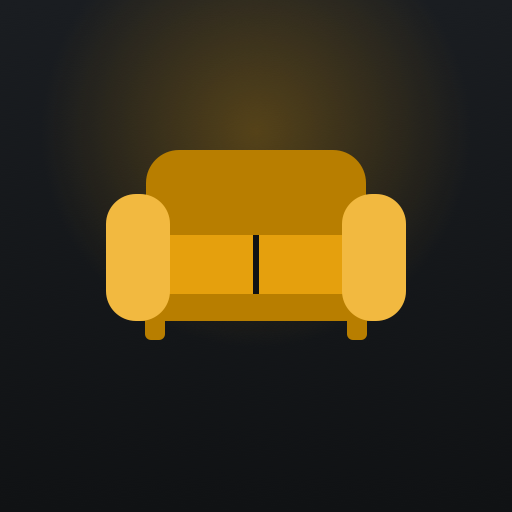
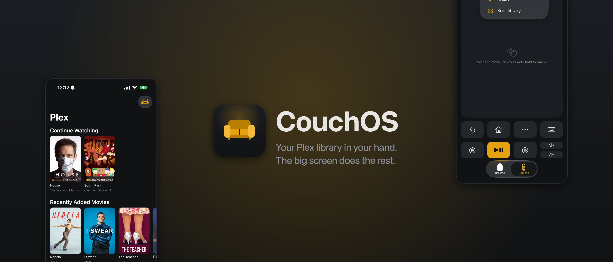
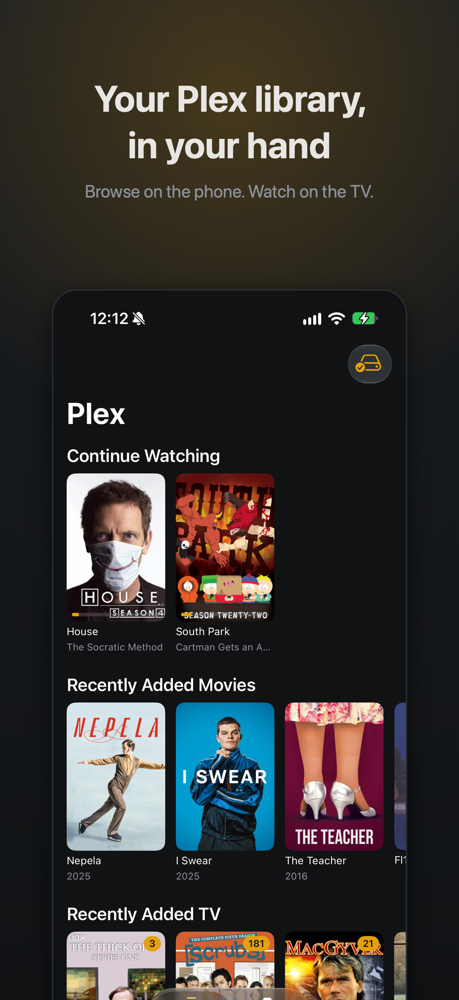
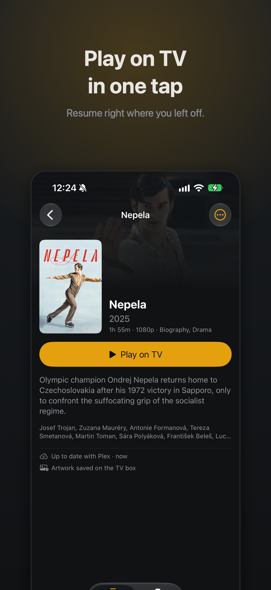
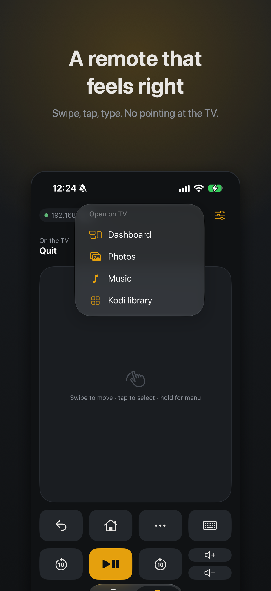
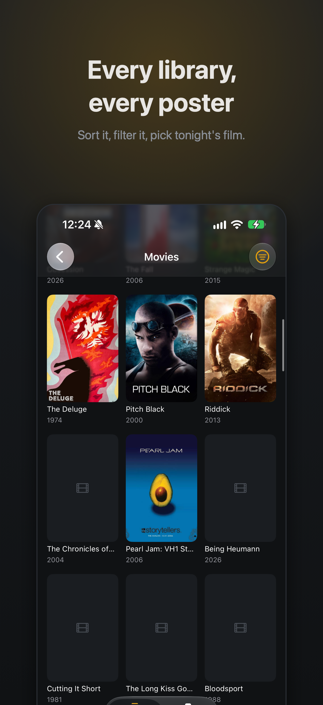

<p align="center">
  
</p>

<h1 align="center">CouchOS for iPhone</h1>

<p align="center">The remote for your CouchOS TV box: browse Plex on the phone, play it on the TV.</p>

<p align="center">
  <a href="https://couchos.dubec.dev">Website</a> ·
  <a href="#beta">TestFlight beta</a> ·
  <a href="CHANGELOG.md">Changelog</a> ·
  <a href="docs/BRAND.md">Style manual</a> ·
  <a href="docs/PRIVACY.md">Privacy</a>
</p>

<p align="center">
  
</p>

<table>
  <tr>
    <td align="center" width="25%"><br><sub><b>Your library, in your hand</b></sub></td>
    <td align="center" width="25%"><br><sub><b>Play on TV in one tap</b></sub></td>
    <td align="center" width="25%"><br><sub><b>A remote that feels right</b></sub></td>
    <td align="center" width="25%"><br><sub><b>Every library, every poster</b></sub></td>
  </tr>
</table>

---

CouchOS turns a Raspberry Pi into the TV's whole world: Plex in kiosk mode,
AirPlay that takes over and hands back by itself, and a quiet dashboard when
idle (see the [project README](../../README.md)). This app is its remote. It's a
small SwiftUI app with no dependencies, no accounts and no server of its own,
and it talks only to the box on your Wi-Fi.

- **Browse** your Plex library from the box's index (it answers in
  milliseconds) and **Play on TV**. The TV plays it; the phone never streams.
- **Remote:** an Apple TV-style touchpad, with momentum, tap to select and hold
  for the menu.
- **Type on the TV** with the phone's keyboard. It opens by itself when the TV asks for text.
- **TV power, volume, Bluetooth speakers and AirPlay**, all in one sheet.

| | |
|---|---|
| Bundle ID | `dev.dubec.couchos` |
| Version | see [`Config/Version.xcconfig`](Config/Version.xcconfig) and [CHANGELOG.md](CHANGELOG.md) |
| Requires | iOS 18 or later, iPhone, a CouchOS box on the same network |
| Website | [couchos.dubec.dev](https://couchos.dubec.dev) |

## Beta

The app is in **TestFlight beta**. Join with the invitation link, install
TestFlight, and open CouchOS on the same Wi-Fi as your box. Allow **Local
Network** when asked, because the box can't be found without it.

To send feedback, take a screenshot and share it to TestFlight, or open
TestFlight → CouchOS → Send Beta Feedback. The version and build are in the
sliders sheet → About.

How builds are versioned, uploaded and opened to testers: [RELEASING.md](RELEASING.md).

## Build and run

Needs Xcode 26 or later.

```sh
open CouchOS.xcodeproj           # then pick your iPhone and Run
```

Signing is automatic with team `3D6D8LQ6F2`. To build under your own team,
change the team and the bundle ID in the target's Signing & Capabilities.

From the shell, for a simulator build (the check every change must pass):

```sh
xcodebuild -project CouchOS.xcodeproj -scheme CouchOS \
  -destination 'generic/platform=iOS Simulator' build
```

In the simulator, the app finds a box only if the Mac is on the box's network.

## How it talks to the box

| Channel | Transport | Used for |
|---|---|---|
| Kodi JSON-RPC | one persistent TCP socket to `:9090`, Nagle off | keys, typing, now playing, keyboard requests (pushed) |
| couchd | HTTP keep-alive to `:8765` | TV power, volume, Bluetooth, status (Server-Sent Events), Plex catalog and Play on TV |

The latency-critical path goes straight from the phone to Kodi: one small
write per key, with no HTTP and no proxy hop. Haptics fire as the command is
sent. The box is found over Bonjour (`_couchos._tcp`) and resolved to an IPv4
address once, so later commands don't wait on mDNS lookups. Until one is found,
or if Local Network access is off, the app says so and offers what fixes it:
the Settings button, or entering an address by hand.

## Using it

### Browse

The Plex catalog from couchd's index on the box:

- Home rows (Continue Watching, Recently Added, …) and libraries as poster grids,
  with sort and "unwatched only".
- Search as you type, with scopes (all, movies, shows, episodes) and recent searches.
- A movie or episode has **Play on TV**, **Resume** and **Play from the start**.
  A show or season offers its next episode (**Resume S01E04**) and lists its children.
- The phone never streams: Plex on the TV plays the item, and the box fetches it
  from the server. Playing something switches to the Remote tab. If AirPlay is on
  screen, the app asks before playing over it.
- **Long-press** any poster or row (or tap ⋯ on its screen) to play it, refresh it
  from Plex, or save or remove its artwork on the box, for it and everything under
  it. Pull down on a detail screen to refresh it.
- The **drive button** (top right) shows the index's state, with a spinner while
  syncing and a thin progress bar under the title, and opens the index: libraries
  in or out of it, keep artwork, check for changes, full sync, artwork cache, rebuild.

### Remote

- **Touchpad:** swipe for one step per 34 pt (keep dragging to keep moving; a
  fast flick coasts), tap to select, long press for the context menu.
- **Buttons:** Back, Home (Plex), Menu and Keyboard, then rewind and forward
  10 s, Play/Pause, and volume.
- **Keyboard:** opens by itself when Kodi asks for text (search, server address).
  Every keystroke is mirrored to the TV, and Return confirms.
- **Grid button:** opens the dashboard, Photos, Music or Kodi's library on the TV.
- **Sliders button:** TV power over CEC, stop AirPlay, volume, Bluetooth speakers,
  the box's address (found over Bonjour; a typed address stays until cleared),
  restart Kodi, and About (version and build).

### Dashboard, Reminders and Siri

- **Dashboard** (sliders button → Dashboard): the message and to-do list on the
  TV. **Reminders** there shows one Reminders list in the to-do list (dashd's
  board `sync`, source `reminders`). It syncs when the app opens, on every change
  while it is open, and when an item is ticked in the app, which ticks it in
  Reminders too. Synced items are deleted in Reminders, not in the app.
- **Siri and Shortcuts** (`Intents.swift`): Show Dashboard on TV, Turn TV On or
  Off, Set Dashboard Mode, Sync Reminders to TV. They run in the background
  against the last box found, at home only. No home hub is needed; a Shortcuts
  personal automation ("When Reminders is closed" → Sync Reminders to TV, "When
  I join my Wi-Fi" → Show Dashboard) runs them without opening the app.

## Project layout

| Path | What |
|---|---|
| `CouchOS/` | The app: SwiftUI views, `AppModel` (state and actions), `KodiLink` (TCP JSON-RPC), `Couchd`, `Dashd` and `Plex` (HTTP API), `Discovery` (Bonjour), `RemindersSync` (EventKit → the TV's to-do list), `Intents` (Siri and Shortcuts), `Brand` (design tokens) |
| `CouchOS/Assets.xcassets` | App icon (generated), AccentColor, LaunchBackground |
| `CouchOS/PrivacyInfo.xcprivacy` | Privacy manifest: no tracking, no collected data, UserDefaults (CA92.1) |
| `Config/Version.xcconfig` | **The** version and build number |
| `Config/Info.plist` | Bonjour service, local networking, Reminders usage text, export compliance, launch screen |
| `Config/ExportOptions.plist` | `xcodebuild -exportArchive` settings for App Store Connect upload |
| `scripts/release.py` | Version, build and changelog: `show`, `bump`, `set-version`, `check`, `notes`, `release` |
| `scripts/make-icon.swift` | Draws the app icon |
| `scripts/make-marketing.swift` | Composes the App Store screenshots, header and social card from `marketing/raw/` into `marketing/out/` |
| `marketing/` | App Store copy ([APPSTORE.md](marketing/APPSTORE.md)), raw captures and the generated visuals used in this README |
| `docs/BRAND.md` | Style manual: name, icon, colour, type, components, words |
| `docs/PRIVACY.md` | Privacy policy, to host at couchos.dubec.dev/privacy |
| `CHANGELOG.md` · `RELEASING.md` | What changed in each build, and how a build reaches testers |

## Versioning

The app uses semantic versioning (`0.1.0`) for the App Store Version, plus one
build number that goes up with every change to the app and never resets. Every
change gets a line in [CHANGELOG.md](CHANGELOG.md) naming its build, which is
also the text testers see in TestFlight. `python3 scripts/release.py check`
verifies that it all agrees. Claude Code does this through the `app-version`
skill, and only the owner decides when the version itself changes.

## Design

Dark only, amber on ink, one accent per screen. The palette is shared with the
box's web dashboard. Read [docs/BRAND.md](docs/BRAND.md) before adding UI, and
use the `Brand` tokens, never system colours.

## Privacy

The app collects nothing. It talks only to your box, and it keeps the box's
address, recent searches and cached artwork on the phone. Reminders are read
only when a list is chosen for the TV, and go only to the box. See [docs/PRIVACY.md](docs/PRIVACY.md).
