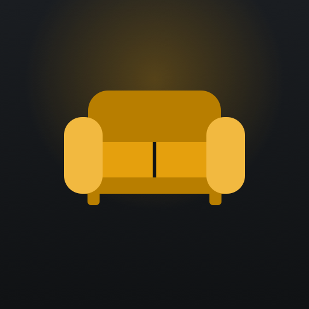

# CouchOS style manual

CouchOS turns a Raspberry Pi into the TV's whole world: Plex, AirPlay and a quiet
dashboard. The phone app is its remote. This manual covers the app and the web
dashboard (`web/index.html`), which share one palette. In code the tokens are
`CouchOS/Brand.swift`, and in CSS they are the custom properties at the top of
`web/index.html`.

## 1. Character

**Warm, calm, out of the way.** It's evening, the lights are low, and you're on
the couch. The app should feel like a good remote: you reach for it without
looking, it does the thing, and it gets out of the way.

- **Dark only.** A TV room is dark, and a bright phone screen is a flashlight in
  your face. The app sets `UIUserInterfaceStyle = Dark`, and there is no light theme.
- **One accent.** Amber, the colour of lamplight. It marks the thing to do
  (Play, the active tab, progress) and nothing else.
- **Content first.** Posters bring the colour. The interface around them stays ink and grey.

## 2. Name

- Always **CouchOS**: capital C, capital OS, one word. Never "Couch OS",
  "CouchOs" or "COUCHOS".
- The hardware is the **TV box** (or "the box"), never "the Pi" in the UI.
  The TV is **the TV**.
- The bundle ID is `dev.dubec.couchos`, and the website is `couchos.dubec.dev`.

## 3. Icon

An amber two-seat couch on ink, lit from above by a soft glow, as if from the TV.

- `scripts/make-icon.swift` generates the icon. Change the script and re-run it,
  never edit the PNGs by hand:
  `swift /abs/path/repos/couchos-app/scripts/make-icon.swift /abs/path/repos/couchos-app`
- It produces three variants: default (ink gradient), dark (pure black, iOS dark
  icons) and tinted (grayscale on black, iOS tinted icons). Each is 1024 × 1024,
  opaque RGB, because App Store Connect rejects an icon with alpha.
- Three amber tones give the shape depth without outlines: light for the arms,
  base amber for the seat, deep for the back and legs. An ink seam splits the
  two cushions.
- Don't add text, a TV outline or a play triangle. The couch alone is the mark.

## 4. Colour

| Token | Hex | Swift | CSS | Use |
|---|---|---|---|---|
| Ink | `#101214` | `Brand.ink` | `--bg` | App background, edge to edge |
| Panel | `#1A1D21` | `Brand.panel` | `--panel` | Cards, touchpad, artwork placeholder |
| Raised | `#23272C` | `Brand.raised` | | Buttons on ink or panel |
| Line | `#2A2E34` | `Brand.line` | `--line` | Hairlines, panel borders |
| Text | `#E8E6E3` | `Brand.text` | `--text` | Primary text (warm white, not pure white) |
| Muted | `#8B9098` | `Brand.muted` | `--muted` | Secondary text, captions |
| Faint | `#4A4F57` | `Brand.faint` | | Decorative glyphs only, **never text** |
| **Amber** | `#E5A00D` | `Brand.amber` | `--accent` | The accent: primary action, active tab, progress |
| Amber deep | `#B87E00` | `Brand.amberDeep` | | Second accent surface (a second swipe action) |
| On amber | `#101214` | `Brand.onAmber` | | Text and icons on amber |
| OK | `#5FB878` | `Brand.ok` | `--ok` | Connected, up to date |
| Warn | `#E0A03A` | `Brand.warn` | `--warn` | Connecting, sync trouble |
| Bad | `#E0605A` | `Brand.bad` | `--bad` | Offline, errors, destructive |

The app's tint and the asset catalog's `AccentColor` are Amber. Native controls
(toggles, links, `.borderedProminent`) pick it up by themselves.

**Contrast** (WCAG 2), measured:

| Pair | Ratio | |
|---|---|---|
| Text on ink / panel / raised | 15.1 / 13.6 / 12.1 : 1 | AAA |
| Muted on ink / panel | 5.9 / 5.3 : 1 | AA |
| Amber on ink, and ink on amber | 8.4 : 1 | AAA |
| OK / Warn / Bad on ink | 7.7 / 8.3 / 5.4 : 1 | AA or better |
| Faint on panel | 2.1 : 1 | fails, so decoration only |

**Rules**

- Never use system colours (`.orange`, `.black`, `.green`, `Color(white:)`) in
  views. Use a token. Lists may keep `.secondary` and `.tertiary`, which adapt
  inside `Form`.
- Text on amber is always ink, never white (white on amber is 2.2 : 1).
- Use amber once per area. If two things on a screen are amber, one of them is wrong.
- Show status with a symbol or a word as well as the colour, never colour alone.

## 5. Type

The system font (SF Pro) with Dynamic Type text styles only, no fixed point sizes.

| Role | Style |
|---|---|
| Screen title | Navigation title (large on Browse, inline on detail screens) |
| Row heading ("Continue Watching") | `.title3.bold()` |
| Item title on a detail screen | `.title2.bold()` |
| Now playing title | `.headline` |
| Body, summaries | `.subheadline`, Muted |
| Captions, poster subtitles | `.caption`, `.caption2`, Muted |
| Numbers that change (volume, counts) | `.monospacedDigit()` |

## 6. Shape and space

| Token | Value | Use |
|---|---|---|
| `Brand.Radius.small` | 10 | Artwork, chips |
| `Brand.Radius.medium` | 16 | Buttons, banners, cards |
| `Brand.Radius.large` | 28 | The touchpad |
| `Brand.gutter` | 16 | Screen edge inset; everything aligns to it |

All rounded rectangles use `style: .continuous`. Use 12 pt between related
controls, 24 pt between sections of a scroll view, and keep tap targets at
least 44 × 44 pt.

## 7. Icons

Use SF Symbols only, no custom glyph art in the UI. Keep a symbol tied to one meaning:

| Meaning | Symbol |
|---|---|
| Browse tab | `square.stack` |
| Remote tab | `appletvremote.gen4` |
| Play on TV | `play.fill` / `play.circle.fill` |
| Open on TV | `tv`, or `square.grid.2x2` for the menu of TV apps |
| Settings sheet | `slider.horizontal.3` |
| Library index | `externaldrive.badge.checkmark`, `arrow.triangle.2.circlepath` while syncing |
| AirPlay | `airplayvideo`, `airplayaudio` |
| Looking for the box | `tv.badge.wifi` |
| Local Network off | `network.slash` |

## 8. Components

- **Primary action:** `.borderedProminent`, tinted amber, ink label, full width
  on detail screens. One per screen (Play / Resume).
- **Secondary action:** `.bordered`, the same width as the primary, directly under it.
- **Remote buttons:** Raised fill, Text glyph, radius 16, 60 pt tall. Play/Pause
  is the one amber button. `PressStyle` gives instant feedback on touch-down
  (scale 0.94, opacity 0.8).
- **Touchpad:** Panel fill with a Line border, radius 28. The hint glyph is
  Faint and the hint text is Muted.
- **Connection pill:** a status dot (OK / Warn / Bad) and Muted text in a Panel capsule.
- **Banner** (AirPlay on screen): an amber card with ink text and a dark
  translucent Stop button.
- **Toast:** a material capsule with a Line border, 2.2 s, for confirming
  background work ("Refreshing Severance from Plex").
- **Empty and error states:** `ContentUnavailableView`, with a title that says
  what's wrong, a description that says what to check, and at most two actions
  (primary first).

## 9. Motion and haptics

- Animations are `.snappy` (about 0.2 s), and content swaps cross-fade.
  Nothing bounces.
- A light impact for every key press, a medium impact for actions that change
  the TV (play, open, power, AirPlay stop). A haptic fires when the command is
  sent, not when it completes.
- `symbolEffect(.rotate)` only while something is actually syncing.

## 10. Words

- **Sentence case** everywhere: "Play from the start", not "Play From The Start".
- **Say what happens**, in the user's terms: "Play on TV", "Save artwork on the
  TV box", "Stop to return to Plex".
- **Errors say what to do next**: "A video is playing on the TV. Stop it first,
  then open the dashboard." No codes, no "failed to".
- **Use "the TV box"**, not Pi, couchd, Kodi or PM4K, except where the user
  meets that name, as with Kodi on the TV.
- Use an ellipsis (`…`) for ongoing states ("Looking for your box…") and
  never for buttons.
- Avoid exclamation marks.
